<!--
PEDRO VILBERT | PROFILE README
Theme: Pixel Art / Retro Gaming
-->

 

---

## 👨‍💻 Sobre mim

Olá! Sou estudante de **Sistemas de Informação no IFPR – Campus Palmas**.

Tenho interesse em desenvolvimento de software, inteligência artificial, ciência de dados e novas tecnologias. Gosto de aprender coisas novas, desenvolver projetos e transformar ideias em soluções.

Atualmente, estou aprimorando meus conhecimentos em programação, análise de dados e desenvolvimento de aplicações.

---

## 📚 Atualmente estudando

| Área | Tecnologias e conhecimentos |
|---|---|
| Inteligência Artificial | Machine Learning, Deep Learning e Redes Neurais |
| Desenvolvimento | Python, Java, PHP e Flutter |
| Ciência de Dados | Pandas, NumPy e Scikit-learn |
| Banco de Dados | MySQL e PostgreSQL |
| Desenvolvimento Web | HTML, CSS e JavaScript |

---

## 🚀 Tecnologias e ferramentas

### 💻 Linguagens de programação

### 🛠️ Desenvolvimento

### 🗄️ Banco de dados

### 🤖 Ciência de dados e inteligência artificial

---

## 📌 Projetos em destaque

---

## 📊 Estatísticas do GitHub

 

---

## 🏆 Conquistas

---

## 🐍 Minhas contribuições

---

## 📫 Entre em contato

---

**"Transformando ideias em código, um projeto de cada vez."**

