\<!--
PEDRO VILBERT | PROFILE README
Theme: Pixel Art / Retro Gaming
\-->

\

\

\

\

\

---

## 👨‍💻 About Me | Sobre Mim

🇧🇷 **Português**

Olá! Sou estudante de **Sistemas de Informação no IFPR – Campus Palmas** e desenvolvedor interessado em tecnologia, programação, inteligência artificial e ciência de dados.

Gosto de explorar novas tecnologias, desenvolver projetos e transformar ideias em soluções práticas. Atualmente, meus estudos estão voltados principalmente para desenvolvimento de software, análise de dados, visualização de informações e aprendizado de máquina.

🇺🇸 **English**

Hello! I'm an **Information Systems student at IFPR – Palmas Campus**, interested in technology, programming, artificial intelligence, and data science.

I enjoy exploring new technologies, developing projects, and turning ideas into practical solutions. My current studies focus mainly on software development, data analysis, data visualization, and machine learning.

---

## 🎯 Current Focus | Foco Atual

| 🇧🇷 Português              | 🇺🇸 English            |
| --------------------------- | ----------------------- |
| Desenvolvimento de software | Software Development    |
| Inteligência Artificial     | Artificial Intelligence |
| Ciência de Dados            | Data Science            |
| Aprendizado de Máquina      | Machine Learning        |
| Visualização de Dados       | Data Visualization      |
| Análise de Dados            | Data Analysis           |

---

## 🛠️ Tech Stack | Tecnologias

\

### 💻 Programming Languages | Linguagens de Programação

\
\
\
\
\
\
\
\

### 🌐 Backend & Frontend | Desenvolvimento

\
\
\
\
\
\

### 🗄️ Databases | Bancos de Dados

\
\
\

### 🤖 Data Science & AI | Ciência de Dados e IA

\
\
\
\
\
\

\

---

## 🚀 Featured Projects | Projetos em Destaque

### 🌪️ Hurricane Trajectory Prediction

🇧🇷 Projeto acadêmico voltado à previsão de trajetórias de furacões utilizando redes neurais LSTM e dados históricos da NOAA. O estudo busca analisar séries temporais e avaliar a capacidade de modelos de aprendizado de máquina na previsão de posições futuras.

🇺🇸 Academic project focused on hurricane trajectory prediction using LSTM neural networks and historical NOAA data. The study analyzes time series and evaluates machine learning models for predicting future positions.

**Technologies:** Python • LSTM • TensorFlow • Machine Learning • NOAA • Data Science

### 🌎 Hurricane Dataset

🇧🇷 Repositório com dados utilizados no estudo de previsão de trajetórias de furacões, baseado em informações históricas disponibilizadas pela NOAA.

🇺🇸 Repository containing datasets used in the hurricane trajectory prediction study, based on historical information provided by NOAA.

**Technologies:** Python • NOAA • Data Analysis

### 📚 Biblioteca PSA

🇧🇷 Projeto de desenvolvimento de um sistema de biblioteca utilizando Java, com foco na aplicação de conceitos de programação e desenvolvimento de software.

🇺🇸 Library management system developed using Java, focused on applying programming and software development concepts.

**Technologies:** Java

---

## 📊 GitHub Stats | Estatísticas

\

\<!-- Generated statistics panel: requires the profile-stats GitHub Actions workflow -->

## 🐍 Contribution Snake | Animação de Contribuições

\

\

\

---

## 📫 Contact | Contato

\

\<a href="[https://github.com/PedroVilbert](https://github.com/PedroVilbert)">
\
\</a>

\<a href="[https://www.linkedin.com/in/pedro-vilbert-6869b3313/](https://www.linkedin.com/in/pedro-vilbert-6869b3313/)"> \ \</a>

\<a href="[https://www.instagram.com/pedro_vilbert/](https://www.instagram.com/pedro_vilbert/)"> \ \</a>

\<a href="mailto\:pedrovilbert2005\@gmail.com"> \ \</a>

\<a href="[https://discord.com](https://discord.com)"> \ \</a>

\

**Email:** [pedrovilbert2005@gmail.com](mailto\:pedrovilbert2005@gmail.com)

**Discord:** `pedro_vilbert`

---

\

\

**"Keep learning, keep building, keep evolving."**

`01010000 01000101 01000100 01010010 01001111`

\

